# Minecraft Projects — Screenshot Proofs

Screenshots from commercial Minecraft projects I built as a Java developer at
[cristalix.gg](https://cristalix.gg) between 2017 and 2022, and from a 2025 project. The source
code of these projects is private, so these photos are the proof of the work: minigames, custom
rendering, procedural generation and server-side optimization.

| Project | Years | What it is |
| --- | --- | --- |
| [ZombieMod](#zombiemod) | 2017 | Humans vs zombies survival minigame |
| [ColorControl](#colorcontrol) | 2018 | Team minigame |
| [SkyBlock](#skyblock) | 2021 | Procedurally generated dungeons and custom item systems |
| [HitTheMobs](#hitthemobs) | 2019–2022 | Mob arena with hundreds of configurable mobs per location |
| [Steal Brainrot](#steal-brainrot) | 2025 | Brainrot-stealing server with custom NPCs and shops |

---

## ZombieMod

*2017 · survival minigame (humans vs zombies)*

Rounds of infection gameplay with custom mob models, an in-game economy and leaderboards. The
leaderboard holograms were drawn with custom OpenGL code on top of NMS instead of the vanilla
scoreboard.

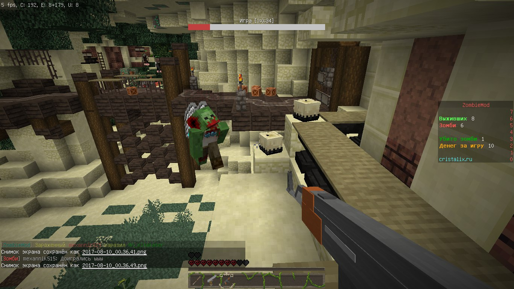

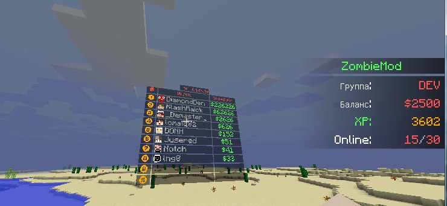

Custom OpenGL-rendered leaderboard hologram above the map (top players by balance) and the player
profile sidebar (group, balance, XP, online).

---

## ColorControl

*2018 · team minigame*

The minigame ran behind multiple BungeeCord proxies, with players distributed into teams and
moved between servers automatically.

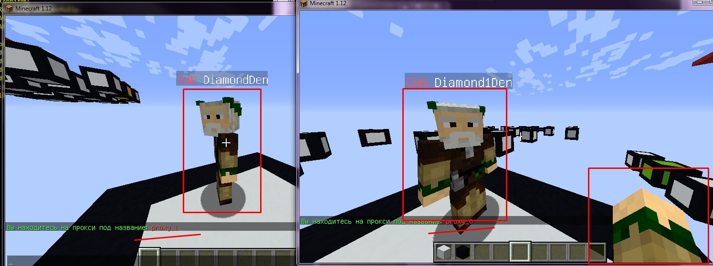

Here I was testing synchronisation between multiple BungeeCord proxies.

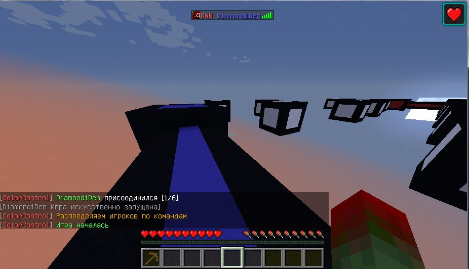

Match start: players joining, automatic team distribution and the start of the round on a colored
arena.

---

## SkyBlock

*2021 · ASkyBlock mechanics: procedural dungeons and custom items*

The SkyBlock world and its mechanics ran at up to 400 concurrent players on a single core after
profiling and optimization.

Top-down dump of a generated dungeon layout: connected rooms and caves produced by the procedural
generator.

The same generator in game: a generated corridor with lanterns, mossy and cracked stone bricks and
iron-bar gates.

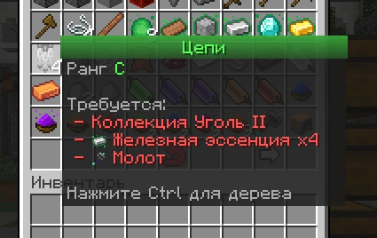

Custom item GUI: an item's upgrade chain with its rank and crafting requirements (collection
level, resources), implemented as a custom inventory UI.

---

## HitTheMobs

*2019–2022 · mob arena with many small locations*

Every location holds a large number of mobs whose stats are fully configurable through JSON
configs stored in git — game content is data, not code.

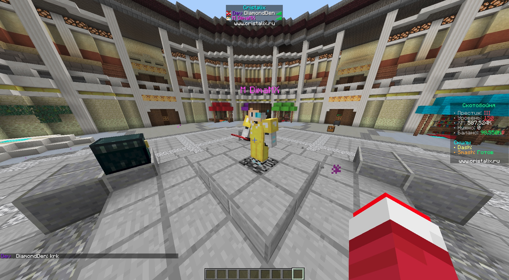

The game hub: profile sidebar (level, XP, balance, skills), XP leaderboard, shops and NPCs.

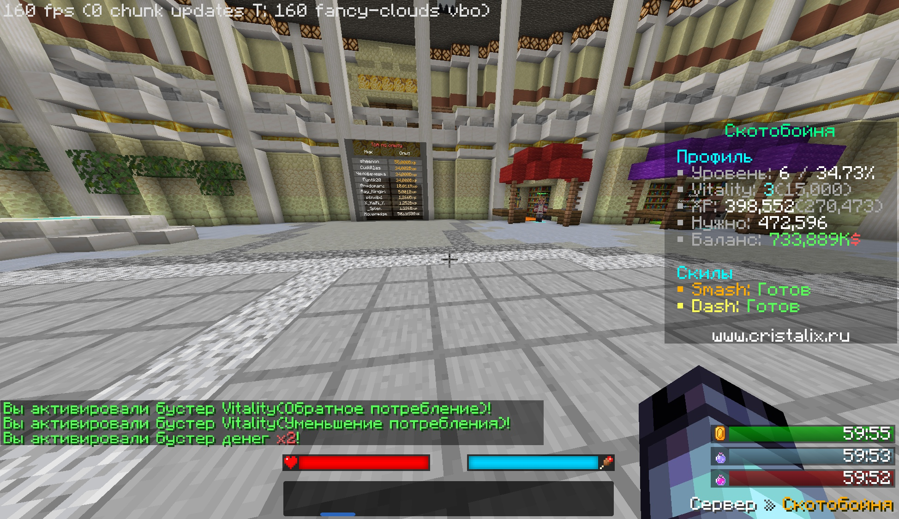

An arena packed with mobs; chat shows activated boosters (Vitality, double money) and the sidebar
shows profile progress.

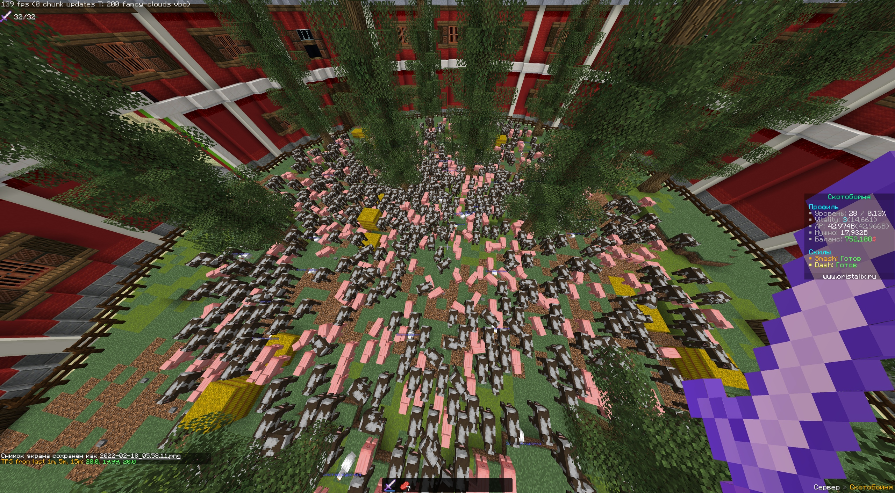

Stress test: hundreds of mobs on a single location while the server stays at 20.0 TPS (1m / 5m /
15m in the debug overlay) — the result of profiling and optimizing the server.

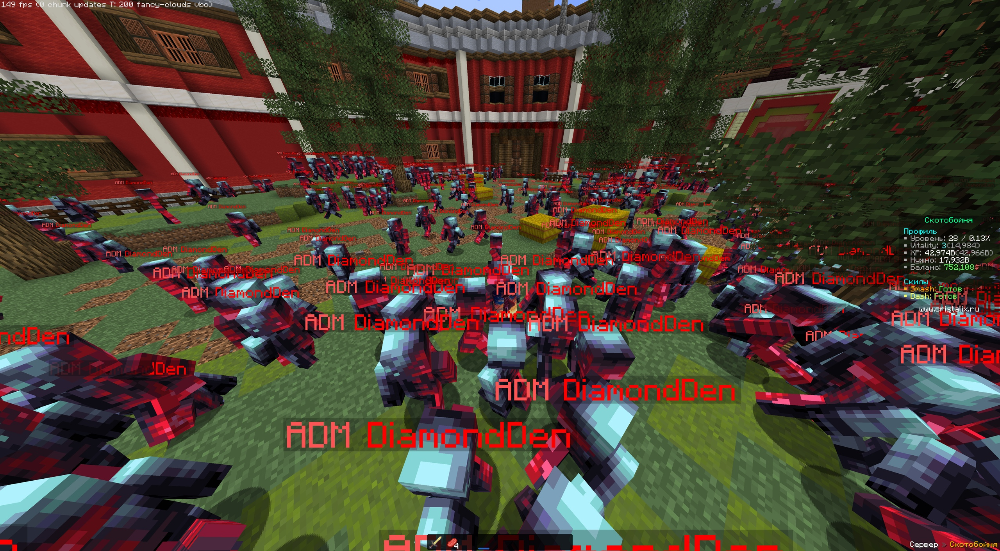

Using custom NMS patches to spawn an EntityPlayer as a regular mob — still at 20 TPS.

---

## Steal Brainrot

*2025 · brainrot-stealing server*

Players steal meme characters from each other's bases while the owners try to defend them.

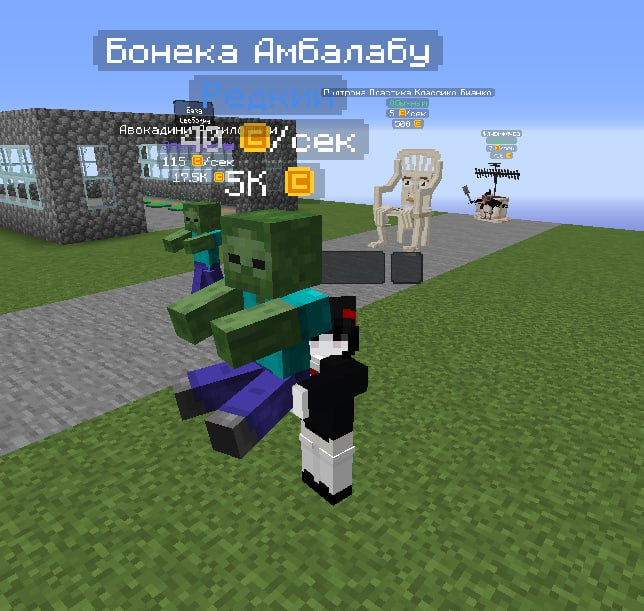

A base area: custom character models with floating name tags and prices above them, alongside
players, pets and a profile overlay.

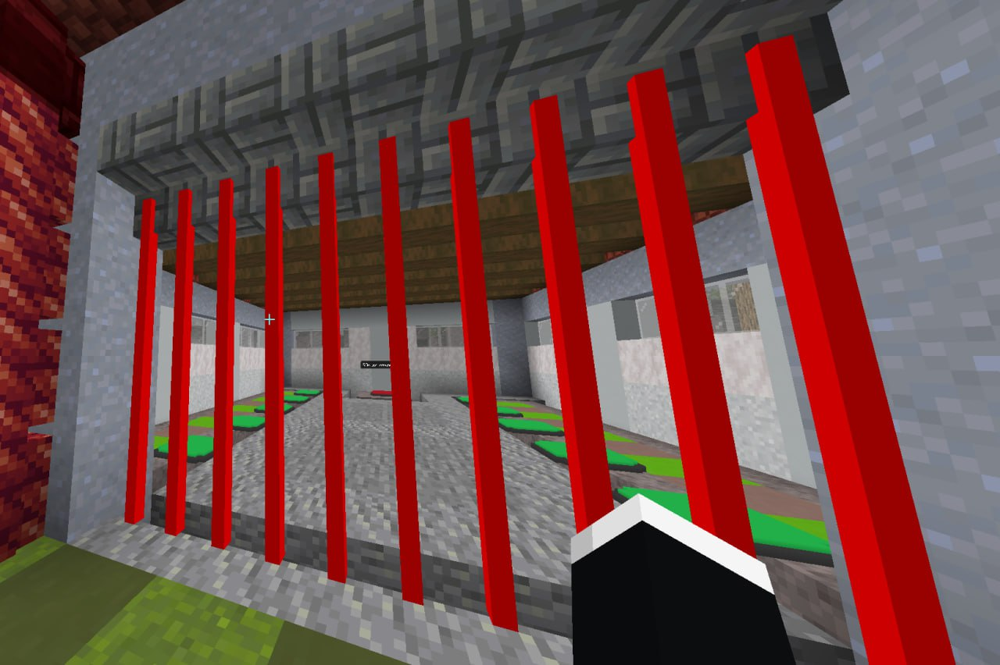

A fenced enclosure with slot platforms for placing characters.

---

*Screenshots are from private projects; the code is not public.*
